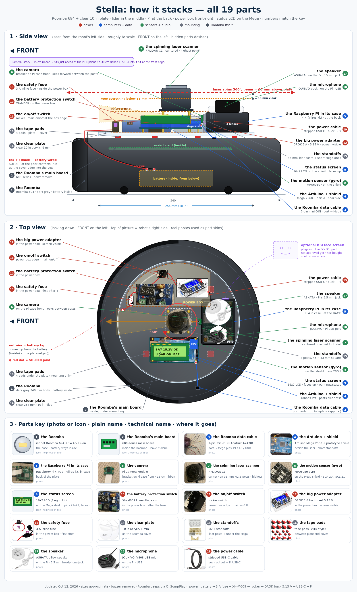
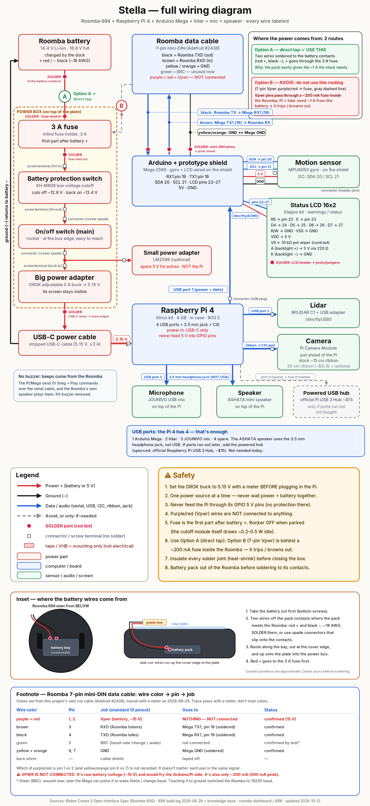

# Stella

A DIY autonomous home robot built on a Roomba 694, with a Raspberry Pi 4 brain, an Arduino Mega 2560 bridge, an RPLIDAR C1, a Pi camera and ROS 2 Jazzy, plus this web dashboard.

Live dashboard (demo mode for visitors): https://roomba-dashboard.vercel.app

---

## The build story

I bought a secondhand Roomba 694 in August with one idea: turn a dumb vacuum into a robot that maps my place and cleans on its own, run from a dashboard I built myself. I named her Stella.

**August to September: the cable hunt.** The plan was simple. Talk to the Roomba over its serial port (iRobot's Open Interface) from an Arduino, then hand that to a Raspberry Pi running ROS 2. The first cable I bought was an 8-pin mini-DIN. It "kind of fit" the Roomba's 7-pin port, and it never lined up TX and RX. I burned a lot of evenings on wire-guessing, test sketches and fake wins before the right 7-pin cable showed up.

**The board that wouldn't talk.** With the right cable in hand, the original board still gave me nothing. Power and ground were fine, but its serial pins sat at 0 V. My 694 has the newer Wi-Fi board, and that board's firmware blocked the serial port (the Open Interface). So on September 23 I ordered a used 600-series mainboard off eBay for about $22.

**September 29: the breakthrough.** The new board arrived, and that day it all came together. I traced every wire with a multimeter, got two-way serial at 115200 baud, and drove the Roomba forward, back and in both spins from my own code. By that night it was streaming sensors, driving under ROS 2 with keyboard teleop, the RPLIDAR C1 was publishing laser scans, and the dashboard's Manual Drive pad was moving the real robot.

**October 11: the Pi died.** I'd been running the Pi off a laptop's USB port and then a cheap power bank. Neither could deliver the ~3 A a Pi 4 needs. It sat under-voltage and throttling at 85 °C, and after one power swap too many it stopped booting. The Mega and the lidar survived. A new Pi 4 is on order, and this time it gets proper power and a fan from day one.

---

## What we're building now

- **Rebuild on the new Pi 4:** wall power and cooling first, boot services so the robot stack starts on its own, and an SD card backup.
- **Mount the lidar and make the first map** (slam_toolbox, driven by hand).
- **Power from the Roomba battery:** a fused direct battery tap, a low-voltage cutoff and a 5 A buck converter into the Pi.
- **Camera feed** on the dashboard.
- **Dashboard v3:** mobile-first and installable (PWA), accessibility fixes, one reliable live connection with reconnects, and a background that reacts to the robot's state.

Ground rule: make it work before making it pretty.

---

## Vision

- **Autonomous cleaning routines:** whole-home mapping, saved maps, scheduled and room-by-room cleaning.
- **"Stella" voice control:** a wake word and a small fixed set of commands. **"Stop" always wins**, with its own always-on path straight to an emergency stop.
- **Camera object detection:** spot cords, socks and other things worth avoiding.
- **Low-battery auto-dock:** head home when the battery is low, and keep nudging until the robot is actually charging, not just parked on the dock.
- **Local-first:** all processing (wake word, speech, mapping, learning) runs on the robot. No cloud dependency. The cloud is only for backups and reports.
- **Continuous improvement:** learn where it gets stuck, how long each room takes, and suggest no-go zones.

---

## Documentation: everything we've tried

### Parts tested

| Part | Role | Result |
|---|---|---|
| Roomba 694 + original Li-ion pack (14.4 V nominal) | Body, wheels, built-in sensors | ✅ Works |
| Original Roomba 694 mainboard (Wi-Fi model) | Roomba controller | ❌ Firmware blocked the serial port (Open Interface). Replaced |
| Used 600-series mainboard (fits 670–694) | Replacement controller | ✅ Serial works, Clean works |
| 8-pin mini-DIN cable | Serial cable (first try) | ❌ Wrong connector. TX/RX never lined up |
| 7-pin mini-DIN cable (Adafruit #2438) | Serial cable | ✅ Cut, traced and wired |
| Arduino Mega 2560 | USB serial bridge to the Roomba | ✅ Works |
| Raspberry Pi 4 4GB (first one) | Brain: Ubuntu Server 24.04, ROS 2 Jazzy | ❌ Died from weak power and heat |
| Raspberry Pi 4 4GB (replacement kit) | Brain | Ordered |
| RPLIDAR C1 + USB adapter | 2D lidar for mapping | ✅ Scans at ~10 Hz. Not mounted yet |
| Pi Camera Module | Camera | On hand, not set up yet |
| MPU6050 (GY-521 / Elegoo shield) | Gyro/accel for heading | On hand |
| LM2596 buck converters (3 A rated) | 5 V power | ⚠️ Too weak for the Pi. Small extras only |
| XH-M609 low-voltage cutoff | Battery protection (~12.8 V) | On hand |
| Cheap USB power bank / laptop USB | Pi power during testing | ❌ Under-voltage. Never again |

### Build layout



*How the current build stacks on the Roomba (side + top view, all 19 parts, sizes approximate). Diagram made by Grok.*

### Lessons learned

- **7-pin vs 8-pin.** The Roomba's serial port is a 7-pin mini-DIN. An 8-pin plug can seem to fit and still never work. Count the wires after cutting, and trace them with a meter, not by color.
- **Baud is 115200.** If the baud rate goes weird, pull the battery for 30 seconds to reset it to 115200.
- **Leave BRC unconnected.** Grounding the BRC pin changes the baud rate. That's probably how mine kept randomly dying.
- **Don't power anything from the 7-pin port.** Its Vpwr pins (~15 V) sit behind a 200 mA fuse (500 mA peak). The Pi, lidar and Mega need far more, so the plan taps the battery directly, with a fuse.
- **Pi power is not optional.** A Pi 4 needs 5 V at about 3 A (5.1 V is best). Laptop USB and cheap power banks can't do it, and that killed my first Pi. Hence the **5 A buck**: the Pi plus lidar plus Mega need about 2.5–3 A at 5 V. A 3 A LM2596 really gives about 2 A, so it isn't enough.
- **Check for under-voltage.** `vcgencmd get_throttled` should read `0x0`. Anything else means power or heat trouble.
- **Never cut power to a running Pi.** Shut it down first.
- **Docked in Full mode won't charge.** The ROS driver runs the Roomba in Full mode, which also turns off its cliff and lift safety stops. Send Dock to drop back to Passive mode, and then it charges.
- **One power source at a time** (never wall and battery together). Never feed the Pi through its GPIO 5 V pins.
- **The dock can't charge and power the load at once.** Switch the add-on electronics off to charge.

### Wiring diagram (description)



*Power chain, fuse Option A (use) / Option B (avoid), mini-DIN pin colors and USB ports for the current build. Diagram made by Grok.*

- **Data:** Roomba 7-pin mini-DIN → Arduino Mega. Roomba TXD (black) → Mega RX1 (pin 19). Roomba RXD (brown) → Mega TX1 (pin 18). Both grounds (yellow, orange) → Mega GND. Vpwr (purple, red) → nothing, never the Mega or Pi. BRC (green) → not connected. Shield taped off. No level shifter needed.
- **Power (planned):** Roomba battery + → 3 A inline fuse → XH-M609 cutoff (off at 12.8 V, back on at ~13.4 V) → rocker switch → DROK adjustable 5 A buck set to 5.15 V → USB-C → Pi 4. The Pi's USB powers the Mega and the RPLIDAR C1. The camera is on the Pi's ribbon port. All grounds go back to battery −.
- **Motion sensor:** MPU6050 on the Mega (SDA pin 20, SCL pin 21, 5 V, GND).
- **Robot stack:** Roomba Open Interface (serial, 115200) → Mega USB pass-through → Pi → ROS 2 `create_robot` driver + `rplidar_ros` → a small FastAPI service → this dashboard over a private network.

---

## Build blog

- Part 1: [Roomba 694 + Raspberry Pi + ROS 2 build log, days 1–3](https://kingsharif.com/blog/roomba-694-raspberry-pi-ros2-build-log-days-1-3)
- Part 2: [The day it finally talked back (serial breakthrough)](https://kingsharif.com/blog/roomba-694-build-log-part-2-serial-breakthrough)

---

## Dashboard features

- **Status:** battery, state, charging and connection, with a living Stella logo whose color and motion follow the robot (green OK, yellow charging, orange low battery, red stopped/fault, gray offline).
- **Manual Drive:** hold-to-drive buttons, WASD/arrow keys, a speed slider and a dead-man stop. STOP is always enabled.
- **Map** (`/map`), with no-go zones and route editing.
- **Camera** (`/camera`) feed view.
- **History** (`/history`) of cleaning sessions.
- **Learning** (`/learning`): a queue for verifying objects.
- **Settings** (`/settings`) and **owner sign-in** (`/login`). Only the owner can control the real robot. Everyone else sees demo mode.
- **Demo mode:** a simulated robot (battery, driving, link drops) so the site works with no robot attached.
- **Reliable live link:** one WebSocket with jittered reconnects, a heartbeat that detects stale data, and clear toasts when the robot is unreachable.

## Tech stack

- Next.js 16 (App Router), React 19, TypeScript
- Tailwind CSS 4, lucide-react icons
- Supabase (owner sign-in)
- Tests: Node's test runner with tsx
- Hosted on Vercel
- Robot side: Raspberry Pi 4, Ubuntu Server 24.04, ROS 2 Jazzy, FastAPI + rclpy, Arduino Mega 2560, RPLIDAR C1

## Local setup

```bash
npm install
cp .env.example .env.local
npm run dev
```

Open http://localhost:3000

Scripts:

| Command | What it does |
|---|---|
| `npm run dev` | Dev server |
| `npm run build` | Production build |
| `npm run start` | Serve the production build |
| `npm run lint` | ESLint |
| `npm test` | Unit tests |

### Environment

Copy `.env.example` to `.env.local` and fill in your own values. Never commit real values.

- `ROBOT_URL`: the robot API origin (server-only). Leave it unset for demo mode.
- `OWNER_EMAIL`: the one account allowed to control the robot.
- `NEXT_PUBLIC_SUPABASE_URL` and `NEXT_PUBLIC_SUPABASE_ANON_KEY`: needed for owner sign-in.

More detail on the data flow and the robot API contract: [`docs/ARCHITECTURE.md`](docs/ARCHITECTURE.md).
