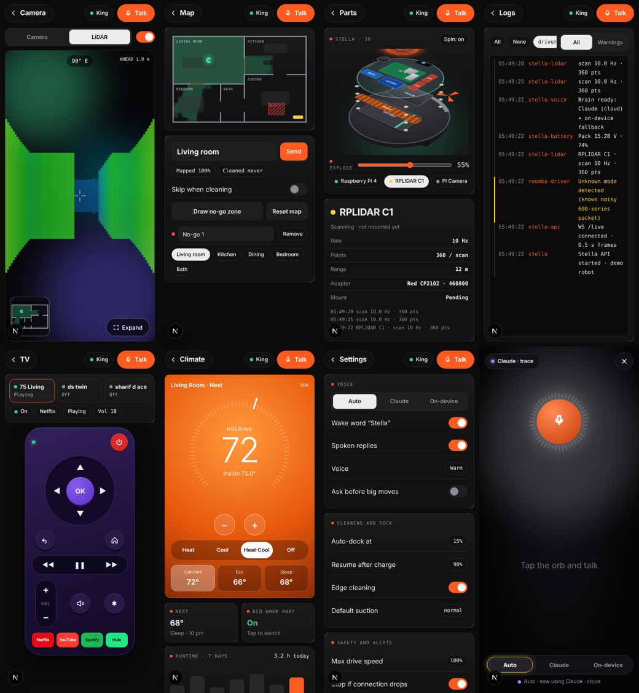
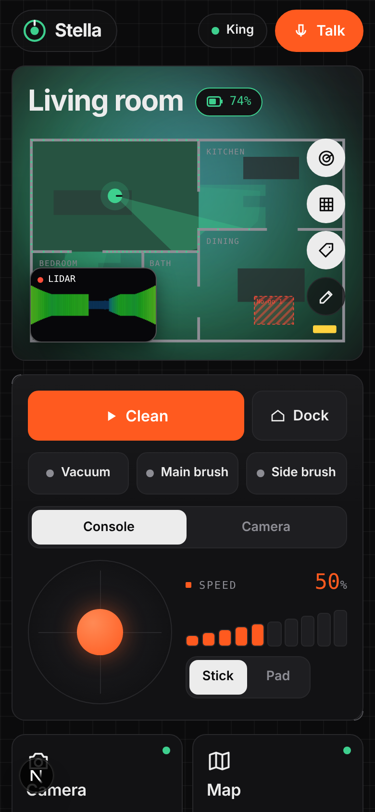
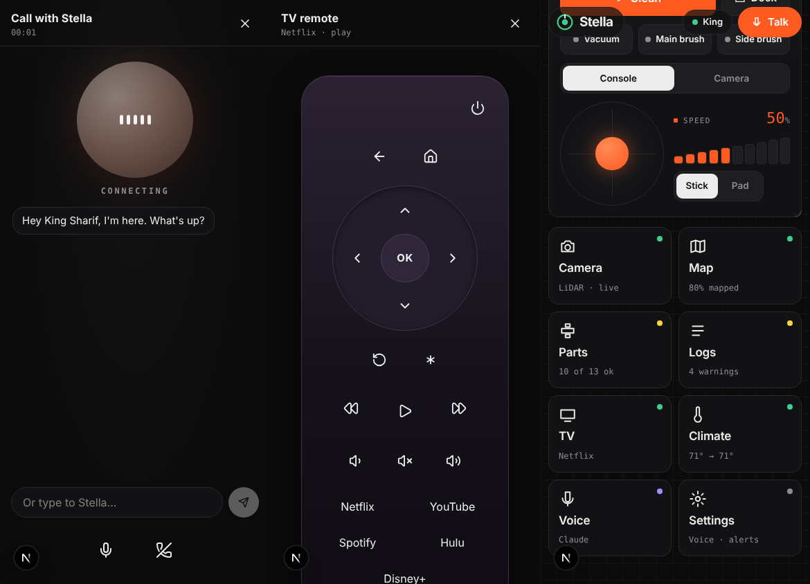
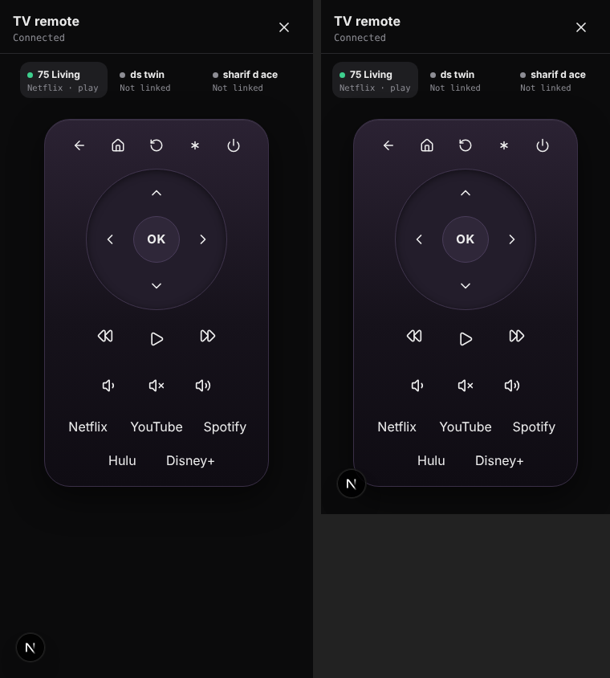

# Stella OS dashboard (`/dashboard`)

The approved interactive mock, ported into the real app. Home = live map + one control card + app grid; every
app (Camera/LiDAR, Map, Parts 3D, Logs, TV, Climate, Settings, Voice) opens full screen.

## Screenshots (captured in a headless browser against a fake robot, not the real Pi)

## Where things live
| Path | What |
|---|---|
| `web/src/app/dashboard/page.tsx` | Route. Client-only (`ssr:false`) so clocks / LiDAR don't cause hydration mismatches |
| `web/src/components/os/template.tsx` | **Generated** from the mock (markup). Change markup here |
| `web/src/components/os/os.css` | Mock styles (scoped under `.sf`) |
| `web/src/components/os/stella-os-impl.tsx` | Behaviour: simulator (demo) + live bridge. `@ts-nocheck` on purpose (ported sim) |
| `web/src/components/os/stella-os.tsx` | Hooks the OS to `useV3Robot()` (connection, battery, mode, clean/dock/wake/motors, voice) |
| `web/src/components/f/f-call.tsx`, `f-remote.tsx` | The call-style **Talk** window and the phone-style **TV remote** from the classic dashboard. Talk button and the Voice tile open the call; the TV tile opens the remote. Mounted in `stella-os.tsx` inside a zero-height `.f` host so they keep their theme variables |
| `web/src/app/dashboard/classic/page.tsx` | The previous Design F dashboard, kept at `/dashboard/classic` |
| `stella_ext_router.py` (lives in the ARK vault: `projects/stella/hardware/pi/`) | New Pi endpoints (see below). **Not deployed or tested on the Pi yet** |

## Demo vs live
* `connection === "live"` (Pi WebSocket opened → on the tailnet): header shows **King**; the simulator's motion is off;
  battery / mode come from WS `/ws` state frames; every control calls the Pi.
* Otherwise: header shows **Demo** and the built-in simulator runs everything (this is what a Vercel preview shows).
* Demo-only things (state simulator chips, "Simulate no internet") are hidden when live.

## Control → endpoint map (live)
| UI | Call |
|---|---|
| Clean | `POST /control/start` (+ `POST /clean` motors on) — *the store did not send start before; fixed* |
| Stop | `POST /control/stop` + `POST /drive {0,0}` |
| Dock | `POST /control/dock` (UI shows "returning" until the Pi reports `docked`) |
| Wake | `POST /wake` |
| Vacuum / brushes | `POST /clean {vacuum, main_brush, side_brush}` |
| Stick / pad | `POST /drive {linear, angular}` ≤ 7 Hz (0.3 m/s, 1.2 rad/s × speed %), zero on release |
| Go to room | `POST /navigate {target, zones}` — **501 until Nav2 exists**; UI says "can't navigate yet" |
| No-go zones | `GET/POST /zones` `{zones:[{x,y,w,h,n}]}` (labels = `n`) |
| Settings / suction / brain | `GET/POST /settings` |
| Logs | `GET /logs?since=<ms>` → `{logs:[{ts,t,src,lv,m}]}` |
| TV remote | `POST /roku/key {key, tv}`, `POST /roku/launch {app, tv}`, `GET /tv/status` (existing) |
| Climate | `GET/POST /climate {set, mode, eco, units}` — stub; **Nest link not built** (Matter or Google SDM) |
| Pose | `GET /pose` → `{x,y,theta}` metres; mapped to the floor plan at 50 u/m from the dock — needs calibration |
| Voice (Talk) | `FCall`: hands-free call. Browser SpeechRecognition → `/api/stella/chat` (Claude, with last turns) → `runCommand()` for TV/drive/dock → browser TTS → listens again. The mock's orb overlay + Auto/Claude/On-device select is still in `stella-os-impl.tsx` but no longer opened (Talk uses the call window); the Settings brain select does not affect the call yet |
| TV | `FRemote` → `POST /roku/key`, `/roku/launch`, `GET /tv/status`. The mock's purple remote page is unused |

Settings, zones, room names, theme, brain and thermostat choices are also kept in `localStorage["stella-os"]`.

## Live connection contract (verified against `robot_api.py`)
* The dashboard opens `wss://<robot>/live` (default; override `NEXT_PUBLIC_ROBOT_WS_PATH`). Earlier code defaulted to `/ws`, which the Pi does not serve.
* Pi frames look like `{battery, state, connected, activity, pose, ...}` (no `type`). The store maps `battery`, `connected` and `activity === "charging"` → docked. Older `{type:"state", mode, ...}` frames still work.
* **No login:** reachable over the tailnet ⇒ LIVE ("King"), otherwise DEMO. See `docs/TAILSCALE.md`.
* Pi CORS (`ALLOWED_ORIGINS` in `robot_api.py`) lists only `roomba.kingsharif.com`, `stella.kingsharif.com`, `localhost:3000`. Vercel preview URLs are not allowed, so previews always show Demo unless `*.vercel.app` is added.
* `POST /control/start` returns `{success:false}` (auto-clean not built). Clean turns the tools on and tells the user.

## Known gaps (honest list)
* Floor plan / rooms / walls are still the mock's apartment; real LiDAR map + room detection is not wired.
* Camera tab says "No camera connected" (Pi Camera isn't detected). LiDAR view is simulated until `/scan` exists.
* Parts panel numbers (CPU temp, volts, currents) are static text, not telemetry.
* Pi endpoints in `stella_ext_router.py` (lives in the ARK vault: `projects/stella/hardware/pi/`) are untested on hardware. Nest, Nav2 and object labelling are not built.
* Vercel preview shows Demo mode (no tailnet). MCP read access to the Vercel project returned 403 for the team scope.

## Dev notes
`npm run build` needs network for Google Fonts (Geist, Schibsted, JetBrains Mono). Regenerating the template: the
converter lived outside the repo; edit `template.tsx` directly from now on.

## Update 2026-10-17 (evening)
* **Map** is King's real apartment (the listing floor plan mirrored left-to-right: balcony side on the left, bedrooms top, dining bottom-left, kitchen bottom-right): Bedroom 1/2, Bath, Hall, Living room, Kitchen, Dining. Hardwood = kitchen, dining, bath; carpet everywhere else. Geometry lives at the top of the `StellaOSImpl` constructor (plan px → world units). Dock position `this.DK` is a guess (east wall of the living room). Saved zones/room names use localStorage key `stella-os-v3` (voice output lives in `stella-voice-out`; default no-go zone: "Chimney", the fireplace corner of the living room) (old mock-apartment zones are dropped).
* **TVs:** the Pi `GET /tvs` lists every Roku by name with power/app/player; the remote strip and TV app show green when a set is on. `/roku/key` and `/roku/launch` now honour the `tv` name (a TV that isn't on the LAN gives an error instead of driving a different one). Fixed IP per name: `settings.tvIps = {"ds twin": "192.168.1.x"}`.
* **Logs** default to "Good" (info only); "All" brings back warnings/errors. **Header** shows one status: Charging / Fully charged / Low battery / Not charging / Offline.
* **Settings:** removed "Signed in as King". New: "Voice plays on" (Device / Pi speaker / Both → Pi `POST /speak`, Piper) and "Go dock when idle" (Off/5/10/20 min → Pi idle loop sends the dock command; off by default, untested on the robot).
* **Camera → LiDAR** shows the live `/scan` from the Pi (`GET /lidar`) when connected; demo mode keeps the simulator view. No LiDAR recording service exists in the repo, so this is the live feed, not a replay.

## Pi voice brain visibility (Settings → Voice)
- **Pi voice brain** row shows what Stella is really using: `Claude · haiku-5-5` or `Offline – <reason>` (no key / daily limit / paused after errors). Tap it for the last error.
- **Test Pi brain** runs one real Claude call from the Pi (`POST /ai/test`) and shows the exact error (wrong key, no internet, billing, bad model).
- Backed by `GET /ai/status` + `POST /ai/test` in `stella_ext_router.py`; status persisted by `ai_router.py` in `~/.cache/stella-ai-status.json`. Rows only show when the Pi is reachable.

## Charge button + remote apps on top
- Home shows a **Charge** button (sends Stella to the dock) whenever she isn't already charging, even while moving.
- TV remote: app shortcuts (Netflix, YouTube, Spotify, Hulu, Disney+) are now the first row.

## Self-check (Settings → Voice)
**Self-check** runs the Pi's read-only health look (`GET /selfcheck`): CPU temp/power, services, mic/speaker/serial devices, Wi-Fi/internet/Tailscale, TV, thermostat. Shows "All good" or "N issues" and speaks the top two problems.
- Old URL: `/demo` (and `/demo/classic`) permanently redirect to `/dashboard`.

## Clean button, Logs filters, 3D model (2026-10-17, later)
- **Clean (live):** checks state first (asleep/offline → "Tap Wake", on the dock → "Tap Wake, then drive"), then asks the Pi `/control/start`. Only if the Pi says yes does it turn the vacuum/brushes on. Until the lidar map + navigation exist it says "Auto-clean needs the lidar map first" and spins nothing. Header status shows "Asleep or offline" when the Pi isn't reporting.
- **Logs:** Good/All toggle on its own full-width row; source filters wrap on a "Show from" row; log lines wrap on phones.
- **Landing page + `/3d` viewer:** Mega, LCD and MPU removed. Two CP2102 adapters (Roomba, lidar) drawn in the 3D model (`public/3d/model.js`, rebuilt into `viewer.js` with `npx esbuild public/3d/app.js --bundle --minify --format=esm --outfile=public/3d/viewer.js`; bump `?v` in `public/3d/index.html`), the layout figure and the wiring figure. Blog chips + footer now point to the 5 real build-log posts.
